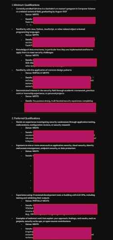
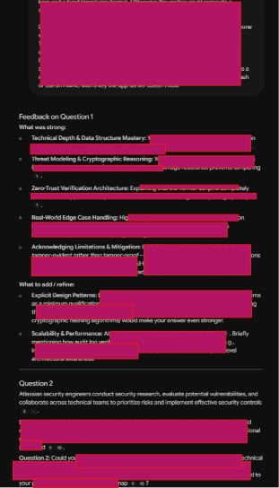
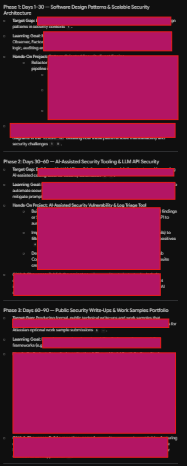

## 1. Project Overview

[] is an AI career coach I built in Google NotebookLM for university students and career changers who want to get into cybersecurity. You give it your experience and a real job description, and it tells you where you already fit, where you partly fit, and where you still need to grow.

I built it around a role I'm actually interested in, so I could test it on myself.

**Career pathway:** Cybersecurity

**Target role:** Security Engineer, New Graduate (2027) at Atlassian

**Built with:** Google NotebookLM

---

## 2. The Problem I'm Solving

Getting into cybersecurity is hard. A lot of people in the field didn't start there. They came from software engineering, IT, networking, or something totally different, and the skills they brought with them ended up mattering. But when you're a student, or you're just starting to switch careers, that's hard to see. Entry-level postings can read like they want years of experience you don't have yet, and it's easy to assume your past work doesn't count.

I'm a computer science student looking at security roles, so this is a problem I'm working through myself. Skills like troubleshooting, writing code for class projects, following procedures carefully, or explaining technical problems to people who aren't technical often line up with what security teams want. The hard part is connecting the dots, and that's what I wanted [] to help with.

**Who it's for:** Students and career changers who want an honest answer to "How close am I to being ready for this job, and what should I work on next?"

---

## 3. How [] Works

I uploaded these sources to NotebookLM so its answers come from real documents instead of general internet advice:

| Resource | Why I included it |
|---|---|
| **Atlassian Security Engineer, New Graduate 2027 job description** | The target role. [] compares my experience against its minimum and preferred qualifications. |
| **OWASP Top 10** | A list of the most common web application security risks. It connects to the application security experience the job prefers. |
| **NICE Cybersecurity Workforce Framework (NIST)** | A government framework that describes cybersecurity roles and the skills behind them. It helps put non-security experience into security terms. |
| **Atlassian's hiring process page** | For interview prep, so the mock questions reflect Atlassian's actual process. |
| **My resume (private)** | The experience being compared. It stays in my private notebook and isn't in this repo. |

A few things I designed it to do:

- **Separate must-haves from nice-to-haves.** The Atlassian posting has minimum qualifications, like being enrolled in a CS-related degree and graduating by August 2027, and preferred ones, like hands-on security research. Knowing the difference means you don't rule yourself out over something that's only "preferred." It also pointed out requirements that aren't skills at all, like the role being hybrid in Seattle with no visa sponsorship.
- **Translate experience.** You share your resume or describe what you've done, and it shows which qualifications that experience supports.
- **Cite its sources.** NotebookLM links each answer back to the documents, so I can click a citation and check it myself.
- **Ask interview questions about your own work.** The mock interview asked me about projects I've actually built instead of generic questions.

---

## 4. [] in Action

### Example 1: Career Guidance (Skills Gap Analysis)

**My prompt:**
> Using the Atlassian job description, compare this experience against the minimum and preferred qualifications to my resume. For each qualification, tell me if I meet it, partially meet it, or have a gap, and cite the source.

**What [] helped me understand:**
It went through every qualification one by one and rated each, with a citation to my resume. Most came back as "Meets," but two were partial. The first was design patterns, which is a minimum qualification. I've taken software engineering, but I don't name any specific patterns on my resume. The second was experience with AI coding tools or LLM APIs. My AI research was in computer vision, not LLMs. It also brought up the hybrid Seattle location and work authorization, which aren't skills but still matter.

### Example 2: Mock Interview

**My prompt:**
> Act as an Atlassian security engineering interviewer. Using the job description and hiring process source, ask me one question at a time. After each answer, tell me what was strong and what I should add, then ask the next question.

**What I learned:**
The questions were based on my own projects. The first asked how I built a SHA-256 hash-chained audit log to detect tampering, and the second asked how I used a weighted risk scorecard to argue for a phased cloud migration in a simulated engagement. The feedback said my threat modeling, my independent verifier, and the way I explained limitations (the log is tamper-evident, not tamper-proof) were strong. It also said I should name the design patterns I used, talk about how my designs would scale, and mention how I'd automate the scorecard. What stuck with me is that the design-pattern gap from my gap analysis came up again in my interview answer. It's not just missing from my resume, it's missing from how I explain my work.

### Example 3: Career Action Plan

**My prompt:**
> Based on my gaps, create a 30/60/90-day plan to become a stronger candidate for this role. Each phase should include one learning goal, one hands-on project, and one way to show my work on GitHub.

**My next steps:**
It gave me a three-phase plan that goes after my gaps, and each phase ends with a public GitHub repo. First a design-patterns project, then an AI-assisted security triage tool that checks the LLM's output, and last a security research portfolio I can link on my application.

---

## 5. Testing and Improving []

**Original attempt:**
> Using the Atlassian job description, compare this experience against the minimum and preferred qualifications to my resume. For each qualification, tell me if I meet it, partially meet it, or have a gap, and cite the source.

The first time I ran this, I'd only uploaded my resume. Instead of guessing, [] summarized my resume, said it couldn't find the job description, and asked me to upload it.

**Improved attempt:**
I added the job description as a text file and ran the same prompt again.

**What changed and why:**
This time I got a full comparison, with a rating and a citation for every qualification. The prompt wasn't the problem. The missing source was. A source based tool can only work with what you give it. I also found that asking for a specific rating plus a citation made the answers much easier to check, since every claim pointed back to something I could open.

---

## 6. Responsible AI

**How I checked []'s output:**
I went back through the gap analysis, interview feedback, and action plan and compared them with my sources and what I know. 

- **It didn't make things up.** When the job description was missing, it asked for it instead of inventing qualifications.
- **It contradicted itself.** It said I met the qualification for having technical write-ups, based on my resume bullets, but then its own 90-day plan listed public write-ups as a gap. Resume bullets aren't really the write-ups Atlassian is asking for, so I'm counting this one as partial.
- **It got something technically wrong.** The plan suggested using the Strategy pattern to switch between SHA-256 and Argon2 in my audit log. Argon2 is a password-hashing algorithm that's slow on purpose, so it doesn't make sense in a hash chain for log integrity. Switching between SHA-256 and SHA3-256 would be a better example.
- **It was a little generous.** It said I covered all five security areas in the posting, but some of that evidence comes from coursework labs and a simulated project. That experience is real, but I want to describe it accurately in an interview instead of making it sound like production work.

**What I watched for:**
In general, I was looking for three things and that's whether its claims actually traced back to a source, whether it was being overconfident or just flattering me, and whether it treated non-traditional backgrounds fairly.

**What should never be shared with this assistant:**
- Contact info like phone numbers, home addresses, or personal emails
- Transcripts, student IDs, or Social Security numbers
- Confidential information from current or past employers
- Passwords, API keys, or undisclosed security vulnerabilities

My resume stayed in a private NotebookLM notebook and isn't in this repo. If you try this with your own resume, keep the notebook private and take your contact info off first.

---

## 7. My 30/60/90-Day Career Plan

This plan came from [] and is built around the gaps it found. Each phase ends with something public on GitHub.

**Days 1–30: Design patterns and security architecture**

I'll learn core design patterns like Strategy, Observer, and Factory, then use them to refactor my Secure Check-In System or build a small security event pipeline. For example, Observer can send login events to multiple audit logs, Factory can create access-control rule checkers, and Strategy can make the hashing algorithm swappable. I'll post it as `security-design-patterns`, with comments and diagrams showing where each pattern is used and why.

**Days 30–60: AI-assisted security tools**

I'll learn how to use an LLM API safely in a security workflow, including checking its output and defending against prompt injection. Then I'll build a tool that takes scan results or SIEM logs, has an LLM summarize the risk, and filters out hallucinations and false positives. I'll use AI coding tools to build it and keep notes on what they got right and wrong. It'll go up as `ai-security-triage-tool`, with tests and a comparison between the AI's summaries and my own analysis.

**Days 60–90: Public write-ups and portfolio**

I'll learn threat modeling (like STRIDE) and how to write a clear security report. Then I'll do a full security review of an open-source app or one of my own projects and write up the threat model, how I validated each finding, and the fixes and trade-offs. I'll post it as `security-research-portfolio` and link it as a work sample when I apply.

---

## 8. Reflection

**1. What was the most useful thing [] did?**

The mock interview. It asked me about my own projects and connected its feedback to what the job actually asks for. It showed me I can explain my technical work pretty well, but I need to start naming design patterns and talking about scale and automation, which is a big part of this role.

**2. What was one limitation or mistake I discovered?**

It isn't always consistent or correct. It said I met the write-up qualification and then listed write-ups as a gap, and it suggested Argon2 for something Argon2 isn't meant for. I treat its answers as a solid first draft that I still need to double-check.

**3. How could this assistant help someone in a real job?**

Someone already working in IT or software could use it to prepare for a move onto their company's security team by comparing their experience to an internal job posting. It would also help with practicing how to explain technical decisions to non-technical people, which came up in my mock interview.

**4. What would I improve in a future version?**

I'd tell it to grade strictly and not round up when the evidence is thin. I'd also add a design-patterns resource and more job descriptions so you could compare a few roles at once, and I'd suggest uploading a resume with contact info removed.

---

## 9. Skills Demonstrated

- Prompt engineering: wrote and tested prompts for a gap analysis, mock interview, and career plan
- AI output evaluation: checked answers against sources and caught a contradiction and a technical mistake
- Research and source curation: picked credible cybersecurity and career resources
- Responsible AI: kept my resume private and redacted every screenshot
- GitHub documentation: turned the project into a portfolio case study
- Career readiness: mapped my own experience to a real security engineering role
